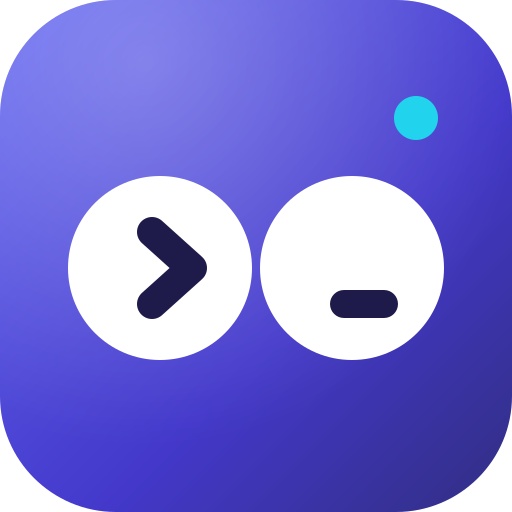
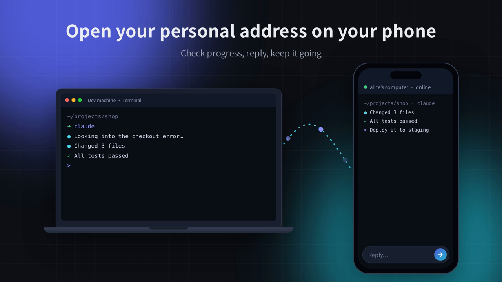

<div align="center">



# Looklook

**Run Claude Code, Codex or any CLI agent on your own machine. Check on it from your phone.**

Close the tab and the work keeps going. No VPN, no port forwarding, no phone app.

[](https://github.com/imythu/looklook/stargazers)
[](https://github.com/imythu/looklook/releases/latest)
[](https://github.com/imythu/looklook/releases)
[](LICENSE)
[](#platforms)

[Website](https://looklook.dev) · [Download](https://looklook.dev/download) · [Docs](https://looklook.dev/docs) · [Roadmap](https://looklook.dev/roadmap) · [Releases](https://github.com/imythu/looklook/releases)

[简体中文](README.md) · **English**

[](https://looklook.dev/media/looklook-promo-en.webm)

<sub>▶ Click to watch the 36-second demo</sub>

</div>

## Why Looklook

You start a long Claude Code or Codex task, then you have to leave the desk. The agent stops to ask a question, and nobody answers until you're back.

Looklook puts every terminal on your laptop, Linux server or homelab behind one personal address. Open it in any phone browser, read what the agent did, type a reply or paste a screenshot, and walk away again. The session keeps running on your machine.

## Quick start

```bash
curl -fsSL https://looklook.dev/install.sh | sh   # Linux / macOS: installs a background service, verifies SHA-256
looklook login                                    # optional: turn on remote access, approve from your phone
```

It works right away, no account needed: open `http://127.0.0.1:1234` on that machine, or turn on LAN access to reach it from phones on the same Wi‑Fi. To use it from anywhere, run `looklook login` to turn on remote access; your personal address is shown after you sign in. On Windows and macOS you can use the [desktop installer](https://looklook.dev/download) instead.

## Free and Remote

|  | Free | Remote |
| --- | --- | --- |
| Price | Free, no account | Free for your first year, then tentatively $7.77/month (¥9.99 in China) |
| Terminals and AI sessions that keep running | ✓ | ✓ |
| Claude Code, Codex, OpenCode or any CLI | ✓ | ✓ |
| Chat view, task board, files, Git, SSH hosts, MCP | ✓ | ✓ |
| Notifications (Feishu / Lark, WeCom, DingTalk, Bark, ntfy) | ✓ | ✓ |
| Open it from phones on the same Wi‑Fi | ✓ | ✓ |
| Open it from anywhere in any browser (personal https address) | — | ✓ |
| Direct connection first, automatic relay fallback | — | ✓ |
| Up to 7 machines on one page | — | ✓ |
| Preview and share local pages from anywhere | — | ✓ |
| Settings synced between machines | — | ✓ |

Prices are tentative and may go up or down with server costs when paid plans open; payment isn't open yet.

## What it does

- **Every agent, any auth.** Looklook works at the terminal level. Claude Code and Codex start in one tap, and anything else (Gemini CLI, OpenCode, Kimi, Qwen Code, htop, vim, `docker logs`) runs as is, whether it signs in with a subscription, an API key, Bedrock, Vertex or your own gateway.
- **Sessions that survive.** A bundled tmux (`looklook-mux`; `psmux` on Windows) keeps terminals alive through closed tabs, dropped connections and app restarts.
- **Up to 7 machines on one page.** Every terminal on every signed-in computer, grouped by machine.
- **Local pages.** Put `localhost` dev servers under your address and open them anywhere. Codex and Claude Code can add them themselves through a local MCP server.
- **Images and files for your agent.** Paste or upload screenshots and they reach Codex and Claude Code as images. Upload into the terminal's folder; `rz`/`sz` and `trzsz` work too.
- **Built for headless boxes.** It runs as a systemd user service or launchd agent, updates itself when idle, and has a System page for CPU, memory, disk and network.
- **Phone-friendly terminal.** A key bar for Esc, Tab, arrows and Ctrl combos, plus OSC 52 copy to the browser clipboard.
- **Chat view and task board.** Claude Code and Codex replies become cards with buttons to approve and answer; every agent session on every machine is grouped into "needs you / working / just finished".
- **Notifications where you are.** Feishu / Lark (respond right on the card), WeCom, DingTalk, WeChat via ServerChan or PushPlus, Bark and ntfy, with quiet hours, batching and stuck reminders.
- **Safety net.** Dangerous commands pause until you confirm, and every turn saves a checkpoint you can roll back to.
- **OpenClaw and Hermes, safely remote.** Recognizes OpenClaw, the Hermes dashboard and Hermes web UIs listening on your machine and puts them under an address only you can open, without opening any port.

## How it compares

|  | Looklook | Claude Code Remote Control | Codex remote | Happy | SSH + VPN + tmux |
| --- | --- | --- | --- | --- | --- |
| Install on the phone | Nothing, any browser | Claude app | ChatGPT app | Happy app | SSH app + VPN app |
| Agents | Any CLI: Claude Code, Codex, Gemini CLI, OpenCode, Kimi… | Claude Code only | Codex only | Claude Code, Codex | Any CLI |
| Sign-ins that work | Whatever your CLI uses: subscription, API key, Bedrock, Vertex, third-party plans | claude.ai subscription only | ChatGPT account | Whatever your CLI uses | Whatever your CLI uses |
| What you see | Full terminal + chat view | Chat | Chat | Chat | Full terminal |
| Network setup | None, outbound tunnel | None | None | None | VPN on every device |
| Sessions survive a closed tab | Yes, tmux bundled | Yes | Yes | Yes | If you set up tmux |
| Several machines on one page | Up to 7 | — | — | Yes | One at a time |
| Phone keyboard for Esc / Ctrl / arrows | Yes | Not a terminal | Not a terminal | Not a terminal | Depends on the app |

## How it works

```
phone / any browser ──HTTPS──▶ Looklook relay ──Noise tunnel──▶ this app ──▶ ttyd + tmux on 127.0.0.1
                                     ▲                               │
                                     └── platform: accounts, routing, short-lived access tokens
```

- The app opens an outbound, Noise-encrypted tunnel (rathole) to a relay, so no inbound ports are needed.
- Each remote request carries a short-lived token signed by the platform. **This app verifies it** before anything reaches a terminal ([`src/gateway/`](client/src/gateway)). Terminals listen only on `127.0.0.1` with random credentials.
- The local console listens on `0.0.0.0:1234` but only allows this machine by default. LAN access and an IP allowlist are opt-in, and an access code is optional ([`src/gateway/access.rs`](client/src/gateway/access.rs)).
- Running in Docker? The host's browser reaches the container through a gateway (e.g. `172.17.0.1`), not `127.0.0.1`. Start with `--local-from 172.17.0.1` (or `LOOKLOOK_LOCAL_FROM`, comma-separated IPs or ranges) to treat it as this machine, so local-only settings such as the MCP token can be changed there.

## Security, plainly

- **Console and terminals are end-to-end encrypted:** when you open them remotely, the browser and your machine set up an encrypted WebRTC channel ([`src/rtc/`](client/src/rtc)), directly when possible and through a relay otherwise; relays only see ciphertext. Both sides' key fingerprints are vouched for by platform-issued credentials and the machine's device key.
- **Local pages are the exception for now:** dev servers you put under your address still go through the HTTPS + Noise tunnel shown above, so the relay decrypts HTTPS to forward them (it doesn't store or log content). End-to-end encryption for them is [on the roadmap](https://looklook.dev/roadmap).
- **Your data stays local.** Sessions, files and settings live on your machine; nothing is synced to the cloud.
- **Releases are built here.** The `client-release` workflow in this repo builds every package and publishes it with `SHA256SUMS`. The installer and the in-app updater verify the checksum. Signed update manifests and code-signed or notarized installers are next on the roadmap. Today, Windows SmartScreen and macOS Gatekeeper will warn on first run.

Found a vulnerability? See [SECURITY.md](SECURITY.md).

## What's open and what's hosted

This repository is the **desktop app / client** (`client/`) and the **client ↔ server protocol** (`protocol/`). The client is under AGPL-3.0-or-later and the protocol under MIT (see [License](#license)). The client works fully on your machine and LAN without signing in. Remote access goes through the hosted Looklook service (accounts, relays, personal addresses) and needs a Looklook account: free for your first year; see [Free and Remote](#free-and-remote) for pricing after that.

## Platforms

| Platform | Package | Notes |
| --- | --- | --- |
| Linux x86_64 / arm64 | `.tar.gz` + `install.sh` (systemd user service) | Works headless |
| macOS (Apple silicon) | `.dmg` desktop app, or `.tar.gz` + `install.sh` | Not notarized yet |
| Windows x86_64 | `-setup.exe` desktop app, or `.zip` | **Beta**; not code-signed yet |

## FAQ

**Does it work with my Claude / ChatGPT subscription?** Yes. Looklook doesn't touch your agent's login. Whatever works in your terminal (subscription, API key, Bedrock, Vertex, a custom gateway) works through Looklook.

**Will my Claude or ChatGPT account get flagged for using a third-party tool?** Looklook just starts the official `claude` and `codex` CLIs, the same as typing them in a terminal; they handle sign-in and store their own tokens. Looklook never reads, stores or forwards your subscription tokens and doesn't impersonate an official client. Extra Claude Code accounts are separate config directories started with the official `CLAUDE_CONFIG_DIR` ([`src/claude_profiles.rs`](client/src/claude_profiles.rs)).

**Do I need a public IP or to open a port?** No. The app connects out to a relay, so it works behind NAT, CGNAT and home routers.

**What happens if my phone's connection drops?** Nothing on your machine. The session lives in tmux; reopen the page and you're back where you were.

**Can I use it without the hosted service?** The local console on port 1234 works on your machine and, if you allow it, on your LAN. Access from outside goes through the hosted relays.

## Roadmap

Next up: end-to-end encryption for local pages, signed updates, more notification channels (Web Push, Slack, Telegram, email…), start tasks and review diffs from your phone, shareable previews, and more relay regions. See the [full roadmap](https://looklook.dev/roadmap). Feature requests and 👍 votes in [Issues](https://github.com/imythu/looklook/issues) shape the order.

## Support the project

If Looklook saves you a trip back to your desk, **[give it a ⭐ star](https://github.com/imythu/looklook/stargazers)**. It's the main way other developers find it. Telling a friend who runs agents all day helps too.

[](https://star-history.com/#imythu/looklook&Date)

## Build

Requires Rust, Node.js 20+, python3 + fontTools (fonts), and zig 0.15 (only for building the bundled tmux/ttyd from source).

```bash
cd client
npm ci && npm run build                        # web console → static/
scripts/fetch-vendor.sh fonts linux-x86_64     # ttyd + fonts → vendor/ (SHA-256 checked)
cargo build --release                          # → target/release/looklook
```

Checks: `cargo test`, `cargo clippy --all-targets`, `npm run check:locales`. See [CONTRIBUTING.md](CONTRIBUTING.md) before opening a pull request.

| Directory | Contents |
| --- | --- |
| `client/` | The client: Rust service + React console (`src-ui/`), packaging scripts |
| `protocol/` | Client ↔ server protocol: request signing, gateway tokens, DTOs, error codes |

## License

The client (`client/`) is licensed under the [GNU Affero General Public License v3.0 or later](LICENSE). If you run a modified version that people use over a network, you must offer them its source (AGPL section 13). The app's Settings page links to this repository.

The protocol crate (`protocol/`) stays under [MIT](protocol/LICENSE) because the hosted service uses it too.

Client releases up to and including 1.34.0 were published under MIT and stay available under MIT. All copyright holders agreed to the change.

The chat view adapts parts of CloudCLI UI (https://github.com/siteboon/claudecodeui); see [THIRD_PARTY_NOTICES.md](THIRD_PARTY_NOTICES.md).

Bundled third-party components are listed in [THIRD_PARTY_NOTICES.md](THIRD_PARTY_NOTICES.md). The license covers the code only; the Looklook / 看看 name and logo are not licensed for use by forks.
