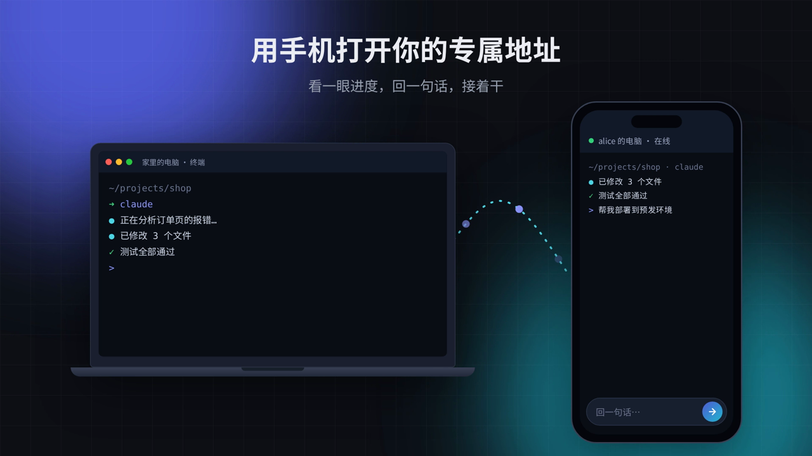

<div align="center">


# 看看 Looklook

**Claude Code、Codex 跑在自己电脑上，手机浏览器随时看一眼、回一句。**

关掉网页任务照样运行。不用公网 IP，不改路由器，手机不用装 App。

[](https://github.com/imythu/looklook/stargazers)
[](https://github.com/imythu/looklook/releases/latest)
[](https://github.com/imythu/looklook/releases)
[](LICENSE)
[](#支持的平台)

[官网](https://looklook.dev) · [下载](https://looklook.dev/download) · [文档](https://looklook.dev/docs) · [路线图](https://looklook.dev/roadmap) · [版本发布](https://github.com/imythu/looklook/releases)

[English](README.md) · **简体中文**

[](https://looklook.dev/media/looklook-promo-zh.webm)

<sub>▶ 点击观看 36 秒演示</sub>

</div>

## 为什么做看看

让 Claude Code 或 Codex 跑一个大任务，人却得出门。它跑到一半停下来问你一句，你不回，它就一直等到你回到电脑前。

看看把你笔记本、Linux 服务器或 NAS 上的所有终端放到一个专属地址下。手机浏览器打开，看看 AI 干到哪了，回一句话或贴张截图，然后继续干别的。任务一直在你自己的电脑上跑。

## 快速开始

```bash
curl -fsSL https://looklook.dev/install.sh | sh   # Linux / macOS：安装为后台服务，校验 SHA-256
looklook login                                    # 用手机批准登录
```

登录后会显示你的专属地址，用手机打开即可。Windows 和 macOS 也可以到[下载页](https://looklook.dev/download)装桌面版。

## 功能

- **任何 AI 助手都能跑。** 看看工作在终端这一层：Claude Code、Codex 一键启动；Gemini CLI、OpenCode、Kimi、Qwen Code、htop、vim、`docker logs` 等照常运行。用官方订阅、API Key、Bedrock、Vertex、国产 Coding Plan 还是自建网关都可以。
- **会话不会丢。** 内置 tmux（`looklook-mux`；Windows 上是 `psmux`），关网页、断网、重启应用，终端都还在。
- **一页管最多 7 台电脑。** 所有已登录电脑上的终端按机器分组显示。
- **本机网页。** 把 `localhost` 上的开发服务挂到你的地址下，在哪都能打开。Codex 和 Claude Code 可以通过本地 MCP 自己添加。
- **给 AI 发图片和文件。** 粘贴或上传截图，Codex 和 Claude Code 直接当图片收到；文件可以传到终端所在目录，`rz`/`sz` 和 `trzsz` 也能用。
- **适合无显示器的服务器。** 以 systemd 用户服务或 launchd 运行，空闲时自动更新，自带系统页看 CPU、内存、磁盘和网络。
- **手机上好用的终端。** 有 Esc、Tab、方向键和 Ctrl 组合键的按键栏，支持 OSC 52 复制到浏览器剪贴板。
- **对话界面和任务看板。** Claude Code、Codex 的回复整理成卡片，点按钮批准、回答；所有电脑上的 AI 会话按“等你处理 / 正在干活 / 刚结束”分组。
- **通知到你常用的地方。** 飞书（卡片上直接处理）、企业微信、钉钉、经 Server酱 / PushPlus 推到微信、Bark、ntfy；有勿扰时段、合并发和卡住提醒。
- **安全网。** 危险命令先停下来等你确认，每一轮自动存检查点，改坏了能回去。
- **安全地远程用 OpenClaw、Hermes。** 认出本机正在监听的 OpenClaw、Hermes 仪表盘和 Hermes 网页界面，一键放到只有你能打开的地址下，不用对外放行端口。

## 和其他方案比

|  | 看看 | Claude Code Remote Control | Codex 远程 | Happy | SSH + 组网 + tmux |
| --- | --- | --- | --- | --- | --- |
| 手机要装什么 | 什么都不用，浏览器即可 | Claude App | ChatGPT App | Happy App | SSH 客户端 + 组网 App |
| 支持的 AI | 任何命令行：Claude Code、Codex、Gemini CLI、OpenCode、Kimi… | 只有 Claude Code | 只有 Codex | Claude Code、Codex | 任何命令行 |
| 能用的登录方式 | 命令行能用的都行：订阅、API Key、Bedrock、Vertex、国产 Coding Plan | 只支持 claude.ai 订阅 | ChatGPT 账号 | 命令行能用的都行 | 命令行能用的都行 |
| 看到的是什么 | 完整终端 + 对话界面 | 对话 | 对话 | 对话 | 完整终端 |
| 网络配置 | 不用，客户端主动连出 | 不用 | 不用 | 不用 | 每台设备都要装组网 |
| 关网页后会话还在 | 在，内置 tmux | 在 | 在 | 在 | 自己配了 tmux 才在 |
| 多台电脑一页看 | 最多 7 台 | — | — | 可以 | 一次连一台 |
| 手机上的 Esc / Ctrl / 方向键 | 有 | 不是终端 | 不是终端 | 不是终端 | 看客户端 |

## 工作原理

```
手机 / 任意浏览器 ──HTTPS──▶ 看看中转 ──Noise 隧道──▶ 本应用 ──▶ 127.0.0.1 上的 ttyd + tmux
                                 ▲                          │
                                 └── 平台：账号、路由、短时访问令牌
```

- 应用主动向中转建立 Noise 加密隧道（rathole），不需要开放任何入站端口。
- 每个远程请求都带平台签发的短时令牌，**由本应用校验**后才会到达终端（[`src/gateway/`](client/src/gateway)）。终端只监听 `127.0.0.1`，凭据随机生成。
- 本地控制台监听 `0.0.0.0:1234`，默认只允许本机访问；局域网访问和 IP 白名单需手动开启，访问码可选（[`src/gateway/access.rs`](client/src/gateway/access.rs)）。
- 跑在 Docker 里？宿主机浏览器是经网关（如 `172.17.0.1`）访问容器的。启动时加 `--local-from 172.17.0.1`（或环境变量 `LOOKLOOK_LOCAL_FROM`，逗号分隔的 IP 或网段），就会被当作本机，MCP 令牌等仅限本机的设置也能在那里改。

## 安全，说清楚

- **管理台和终端端到端加密：** 远程打开时，浏览器和你的电脑之间建一条 WebRTC 加密通道（[`src/rtc/`](client/src/rtc)），能直连就直连，不行再经中转转发，中转只看到密文。双方的密钥指纹由平台签发的凭证和电脑的设备密钥担保。
- **本机网页暂时例外：** 放到专属地址下的开发网页目前走上图的 HTTPS + Noise 隧道，中转要解开 HTTPS 才能转发（不保存、不记录内容）；它的端到端加密在[路线图](https://looklook.dev/roadmap)上。
- **数据留在本地。** 会话、文件和设置都在你的电脑上，不同步到云端。
- **安装包在这个仓库里构建。** 本仓库的 `client-release` 工作流构建所有安装包并附带 `SHA256SUMS` 发布，安装脚本和应用内更新都会校验。签名的更新清单、代码签名和 macOS 公证在路线图上；目前首次运行时 Windows SmartScreen 和 macOS Gatekeeper 会有提示。

发现漏洞？请看 [SECURITY.md](SECURITY.md)。

## 哪些开源，哪些是托管服务

本仓库包含**桌面应用 / 客户端**（`client/`）和**客户端 ↔ 服务端协议**（`protocol/`）。客户端采用 AGPL-3.0-or-later，协议采用 MIT（见[许可证](#许可证)）。远程访问经由看看的托管服务（账号、中转、专属地址），需要看看账号，目前第一年免费。

## 支持的平台

| 平台 | 安装包 | 说明 |
| --- | --- | --- |
| Linux x86_64 / arm64 | `.tar.gz` + `install.sh`（systemd 用户服务） | 支持无图形界面 |
| macOS（Apple 芯片） | `.dmg` 桌面版，或 `.tar.gz` + `install.sh` | 暂未公证 |
| Windows x86_64 | `-setup.exe` 桌面版，或 `.zip` | **Beta**；暂未代码签名 |

## 常见问题

**能用我的 Claude / ChatGPT 订阅或国产 Coding Plan 吗？** 能。看看不碰 AI 助手的登录，终端里能用的（订阅、API Key、Bedrock、Vertex、自建网关）通过看看照样能用。

**会不会被当成第三方工具封号？** 看看只是启动官方的 `claude`、`codex` 命令行，和你自己在终端里敲一样；登录和令牌都由它们自己管。看看不读取、不保存、不转发你的订阅令牌，也不模拟官方客户端。多个 Claude Code 账号是用官方的 `CLAUDE_CONFIG_DIR` 分开的配置目录（[`src/claude_profiles.rs`](client/src/claude_profiles.rs)）。

**需要公网 IP 或开端口吗？** 不需要。客户端主动连到中转，NAT、运营商大内网、家用路由器后面都能用。

**手机断网了会怎样？** 电脑上什么都不影响。会话在 tmux 里，重新打开页面就回到原处。

**不用托管服务能用吗？** 1234 端口的本地控制台在本机可用，开启后局域网也能用；从外网访问要经过托管中转。

## 路线图

接下来：本机网页的端到端加密、签名更新、更多通知渠道（浏览器推送、邮件…）、手机上发起任务和审阅 diff、可分享的预览、更多中转地区。详见[完整路线图](https://looklook.dev/roadmap)。在 [Issues](https://github.com/imythu/looklook/issues) 提需求或点 👍，会影响开发顺序。

## 支持一下

如果看看帮你省了几趟跑回电脑前的路，**[点个 ⭐ Star](https://github.com/imythu/looklook/stargazers)** 吧，这是其他开发者发现它的主要途径。也欢迎推荐给整天跑 AI 助手的朋友。

交流反馈：QQ 群 1029871265，或在 [Issues](https://github.com/imythu/looklook/issues) 提建议。

[](https://star-history.com/#imythu/looklook&Date)

## 从源码构建

需要 Rust、Node.js 20+、python3 + fontTools（字体），以及 zig 0.15（仅在从源码构建内置的 tmux/ttyd 时需要）。

```bash
cd client
npm ci && npm run build                        # Web 控制台 → static/
scripts/fetch-vendor.sh fonts linux-x86_64     # ttyd + 字体 → vendor/（校验 SHA-256）
cargo build --release                          # → target/release/looklook
```

检查：`cargo test`、`cargo clippy --all-targets`、`npm run check:locales`。提交 PR 前请先看 [CONTRIBUTING.md](CONTRIBUTING.md)。

| 目录 | 内容 |
| --- | --- |
| `client/` | 客户端：Rust 服务 + React 控制台（`src-ui/`）、打包脚本 |
| `protocol/` | 客户端 ↔ 服务端协议：请求签名、网关令牌、DTO、错误码 |

## 许可证

客户端（`client/`）采用 [GNU Affero General Public License v3.0 or later](LICENSE)。如果你运行修改后的版本并通过网络向他人提供服务，需要向他们提供源码（AGPL 第 13 条）。应用的设置页链接到本仓库。

协议 crate（`protocol/`）保持 [MIT](protocol/LICENSE)，因为托管服务也在用它。

1.34.0 及以前的客户端版本以 MIT 发布，仍可按 MIT 使用；所有版权持有人都同意了这次变更。

聊天视图改编自 CloudCLI UI（https://github.com/siteboon/claudecodeui）的部分代码，见 [THIRD_PARTY_NOTICES.md](THIRD_PARTY_NOTICES.md)。

内置的第三方组件列在 [THIRD_PARTY_NOTICES.md](THIRD_PARTY_NOTICES.md)。许可证只覆盖代码；Looklook / 看看 的名称和标志不授权给分叉使用。
